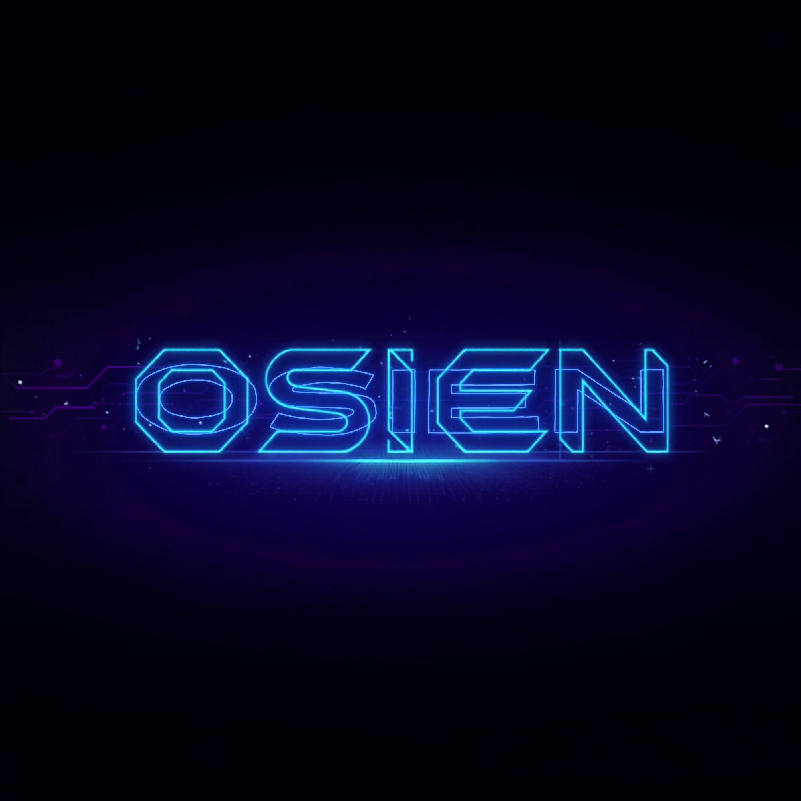

<div align="center">

# OSIEN



> A parent company and monorepo housing a diverse ecosystem of AI tooling, web applications, games, browser extensions, and experimental projects.


</div>

---

## Overview

**OSIEN** is the umbrella organization that consolidates all projects, tools, and experiments under one roof. It serves as a central hub for a wide range of software products — from AI-powered developer tooling and no-code website builders to e-commerce storefronts, browser extensions, games, and social media automation platforms.

This monorepo brings together every project into a single, organized structure for easier management, discovery, and collaboration.

---

## Repository Structure

```
OSIEN/
├── CLIENT/                          # Client-facing projects
│   ├── Driftpost/                   # Social media content scheduling & publishing
│   ├── FameGo/                      # Famebros Studio project
│   ├── Famebook/                    # Booking application
│   ├── kds-studio/                  # KDS Studio website
│   └── parrfums-vault-storefront/   # Perfume e-commerce storefront
│
├── DEAD/                            # Archived / legacy projects
│   ├── Bulk_downloader/             # Bulk video link downloader
│   ├── KeyGen/                      # AI knowledge base & chatbot
│   ├── Keygen.v1/                   # KeyGen v1
│   ├── PyEdit/                      # Python code editor (web)
│   ├── Social-Flow/                 # Social media flow automation
│   ├── game_htm.github.io/          # Game HTML project
│   ├── keepthestyle/                # No-code visual website builder (v0)
│   └── my-case-converter-1.1/      # Case converter utility
│
├── EXPERIMENTS/                     # Experimental & research projects
│   ├── AutoChargingCar/             # Auto-charging car simulation
│   ├── NeoGenesis/                  # 3D planet simulation & AI game
│   └── Synapse/                     # Battle Ground of Two AIs
│
├── Gramiqo/                         # Browser extension
│
├── OCM/                             # OpenCode Marketplace ecosystem
│   ├── OCM Cli/                     # OCM command-line tool
│   ├── OCM Registory/               # OCM registry & schema
│   └── OCM Web/                     # OCM marketplace web frontend
│
├── OSIEN-Forge/                     # AI superpowers: games, sites, brand kits
├── OSIEN-Stack/                     # Portable AI tooling stack (MCP, skills, agents)
├── Record-Common/                   # Video submission & review platform
├── Storyteller_v1/                  # Interactive storytelling platform
└── keepthestyle_v1/                 # Professional no-code visual website builder
```

---

## Projects

### Client Projects

| Project | Description | Tech Stack |
|---------|-------------|------------|
| **Driftpost** | Social media content scheduling, publishing, and automation platform with AI-assisted caption generation | React, Supabase, Vite |
| **FameGo** | Famebros Studio project | — |
| **Famebook** | Booking application | Kotlin |
| **kds-studio** | KDS Studio marketing website | HTML, CSS, JS |
| **parrfums-vault-storefront** | Perfume e-commerce storefront with Supabase backend | JavaScript, Supabase |

### AI & Developer Tooling

| Project | Description | Tech Stack |
|---------|-------------|------------|
| **OSIEN-Forge** | Free AI superpowers: games, websites, brand kits, invoices, self-healing tools | JavaScript |
| **OSIEN-Stack** | Portable AI tooling stack with 45+ MCP tools, skills, commands, agents, and runner | MDX, TypeScript |
| **OCM (OpenCode Marketplace)** | Marketplace ecosystem for OpenCode tools, skills, and packages | Next.js, TypeScript |
| **Synapse** | Battle Ground of Two AIs — interactive AI competition platform | TypeScript, Firebase |

### Applications & Platforms

| Project | Description | Tech Stack |
|---------|-------------|------------|
| **Gramiqo** | Browser extension | JavaScript |
| **Record-Common** | Video submission and review platform with admin dashboard | Next.js, TypeScript, Supabase |
| **Storyteller_v1** | Interactive storytelling platform with audio and Supabase backend | JavaScript, Supabase |
| **keepthestyle_v1** | Professional no-code visual website builder | JavaScript |
| **NeoGenesis** | 3D planet simulation and AI game with physics engine | TypeScript, Three.js |

### Experiments

| Project | Description | Tech Stack |
|---------|-------------|------------|
| **AutoChargingCar** | Auto-charging car simulation | Python |
| **NeoGenesis** | 3D planet simulation with AI and physics | TypeScript |
| **Synapse** | Two-AI battle ground | TypeScript |

### Archived (DEAD)

Legacy and archived projects preserved for reference: Bulk_downloader, KeyGen, Keygen.v1, PyEdit, Social-Flow, game_htm.github.io, keepthestyle (v0), my-case-converter-1.1.

---

## Getting Started

Each sub-project is self-contained. Navigate to the project directory and follow its individual README for setup instructions.

```bash
# Example: Run the OCM Web frontend
cd OCM/OCM\ Web
npm install
npm run dev
```

```bash
# Example: Run OSIEN-Forge
cd OSIEN-Forge
npm install
npm start
```

---

## Tech Stack Overview

- **Frontend:** React, Next.js, Vite, Tailwind CSS, Three.js
- **Backend:** Supabase, Firebase, Node.js, Python
- **AI Tooling:** MCP (Model Context Protocol), OpenCode, custom agents & skills
- **Languages:** JavaScript, TypeScript, Python, Kotlin, HTML/CSS
- **Infrastructure:** Vercel, Netlify, GitHub Pages

---

## Contributing

1. Fork the repository
2. Create a feature branch (`git checkout -b feature/amazing-feature`)
3. Commit your changes (`git commit -m 'Add amazing feature'`)
4. Push to the branch (`git push origin feature/amazing-feature`)
5. Open a Pull Request

---

## License

This project is licensed under the MIT License. See individual project directories for specific license details.

---

## Contact

- **GitHub:** [@kabirprokk](https://github.com/kabirprokk)
- **Email:** kabirsayed.k@gmail.com

---

*Built with passion by Kabir.*
